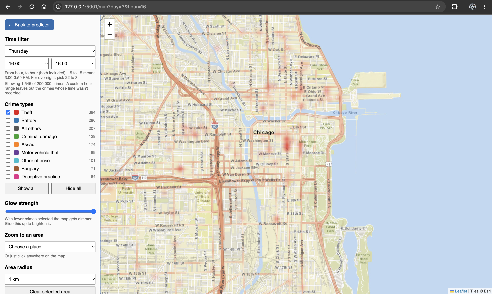
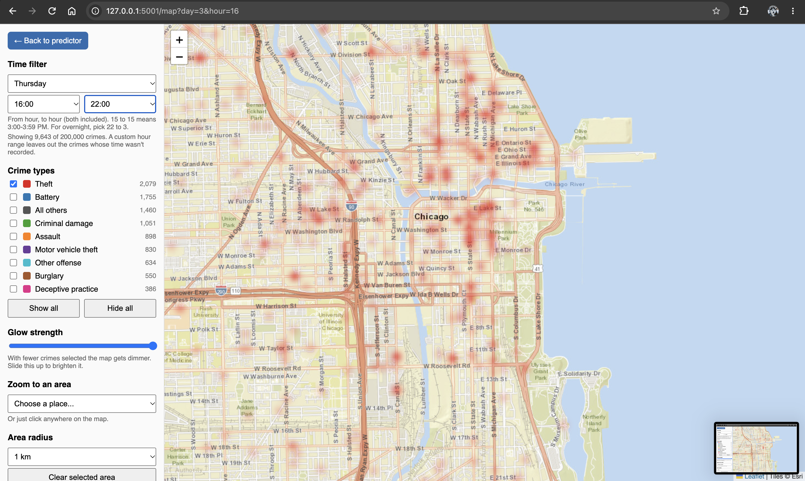
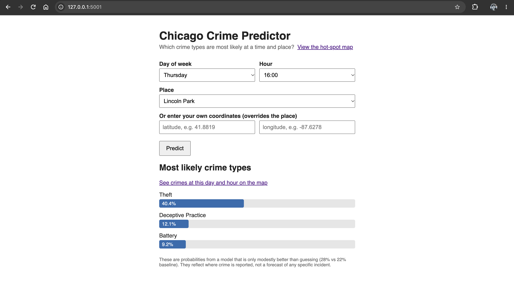

# Chicago Crime Hot-Spot Explorer

A small data-science project: map where crime is concentrated in Chicago and
predict which crime types are most likely at a given time and place.
Rebuilt from my undergraduate project report (St. Joseph's College of
Engineering, 2023), this time with real public data, a proper train/validation/test
split, and a baseline to compare against.

## What it does

- **Hot-spot map** (`/map`): interactive heatmap with a color per crime type,
  a day-of-week and hour filter, and a click-to-select area that shows crime
  counts inside a 0.5 to 3 km circle.
- **Crime-type predictor** (`/`): pick a day, hour and place; the app shows the
  three most likely crime types with probabilities.

## Data

City of Chicago, "Crimes - 2001 to Present" (Chicago Police Department,
open data portal, dataset id `ijzp-q8t2`). The download script pulls the most
recent 200,000 reported crimes that have coordinates. Re-running it later gives
a newer slice, so exact numbers will differ slightly from those below.

## Results (honest version)

Predicting crime *type* from only time and place is a hard problem.

| Measure | Model | Baseline |
|---|---|---|
| Accuracy (9 crime groups) | 28.3% | 21.9% (always guess theft) |
| Top-3 accuracy | 58% | 54% (always the 3 most common) |
| Macro F1 | 0.152 | 0.040 |

- Random Forest, tuned on a validation set; the test set was used once.
- The first untuned forest scored 63% on training data but 28% on test data;
  raising `min_samples_leaf` cut that gap from 36 points to 9.
- The model mostly finds theft and battery. Rare types (assault, deceptive
  practice, other offense) have near-zero recall.

## Data issues found and handled

- About 3.5% of records are stamped exactly 00:00, a placeholder for unknown
  time. They are excluded from the model and from hour-filtered map views.
- The data covers about 10.5 months, so month and day-of-year were deliberately
  not used as features (each would appear only once and could be memorized).

## Limitations

- Data reflects where crime is *reported and recorded*, which also reflects
  policing patterns. This is not a forecast of any specific incident.
- Counts are raw, not per-resident rates; busy areas such as downtown look
  worse partly because of foot traffic.

## Run it

Requires Python 3.
